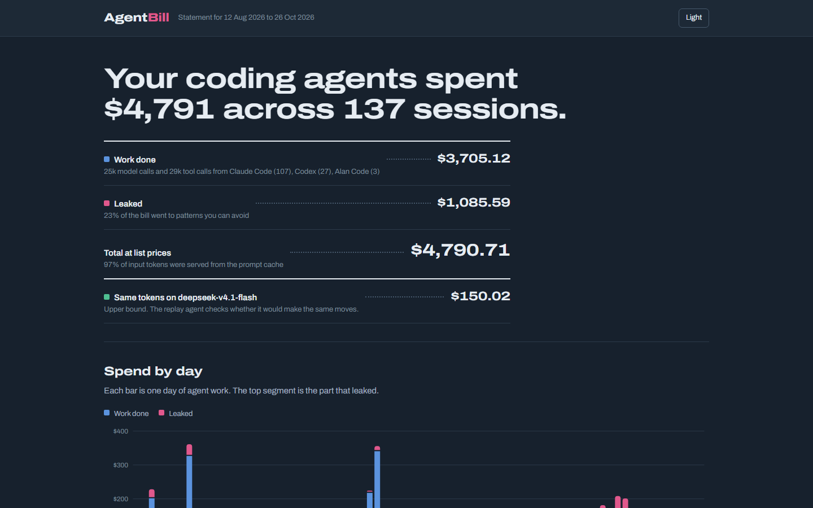
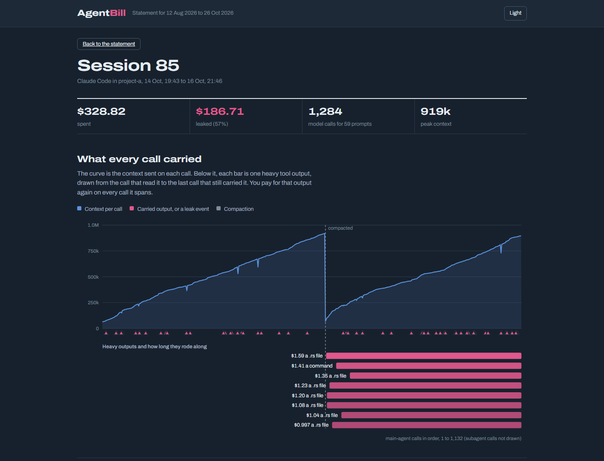

# AgentBill

**See what your coding agents really cost, where the tokens leak, and which steps an open model could do for a fraction of the price.**

AgentBill reads the session logs that Claude Code, Codex, OpenCode and Alan Code already write on your machine, prices every model call at live list prices, and finds the patterns that quietly inflate the bill. Its replay agent then has an open model (DeepSeek, GLM, Kimi) redo your most expensive steps and checks whether it makes the same move.

No proxy, no account, no setup. Nothing leaves your machine unless you run `replay`.

Built solo in 30 hours for **OpenFire by Alan AI** (Oct 26–27, 2026), with Alan agents doing a share of the work (see [Built with Alan](#built-with-alan)).

**Live demo:** [agentbill-topaz.vercel.app](https://agentbill-topaz.vercel.app) (137 anonymised real sessions, no install) · **Demo video (1:31):** [on X](https://x.com/Realthugus/status/2115086753489092613), the OpenFire submission post, covering what it does, how it works and how Alan was used



## Why

Agent runs look cheap one call at a time. Nobody sees the bill come together:

- A 40,000-character install log read early in a session is re-sent on every later call until the context is compacted. It can cost more than the code change it was for.
- Step away for ten minutes and the prompt cache expires. The next call rewrites the whole 800k-token context at the cache-write price.
- Agents re-read files they already have, and retry failing commands in loops.
- Every step pays frontier prices, even the routine ones a cheap open model would get right.

On my own history (137 sessions over 11 weeks across Claude Code, Codex and Alan Code) AgentBill found **$4,798 of spend at list prices, and $1,086 (23%) leaked to avoidable patterns.** The biggest single leak was one call that rewrote 858k tokens of prompt cache because something early in the prompt changed.

## Quick start

```bash
git clone https://github.com/Ansh101112/agentbill && cd agentbill
npm install && npm run build
npm link                    # puts the `agentbill` command on your PATH
agentbill                   # the report
agentbill serve             # the dashboard on http://localhost:4477
```

Needs Node 22.18 or newer. Without `npm link`, use `node dist/cli.js` in place of `agentbill`. During development you can run the TypeScript directly: `node src/cli.ts`.

## What you get

### The report

```
AgentBill · 133 sessions · 2026-08-12 → 2026-10-26 · prices: live

  Spend        $4761.30  24k model calls, 29k tool calls
  Leaked       $1075.44  23% of spend went to avoidable patterns
  Cache hits   97%  of input tokens were served from the prompt cache

  Where it leaked
    Prompt cache rebuilt after idle gaps            $802.02  440×
    Heavy outputs re-sent on later calls            $246.98  540×
    Unchanged files read again                       $24.61  247×
    Retry loops on failing steps                      $7.54  25×

  Same tokens on an open model
    deepseek/deepseek-v4.1-flash          $148.64  −$4612.66
    z-ai/glm-5.3                          $612.97  −$4148.33
```

### The dashboard

`agentbill serve` opens a statement of your agent spend: the bill as line items, spend and leaks by day, leaks by pattern and by model, every session, and what open models would charge for the same tokens.

Each session opens to a timeline of **what every call carried**: the context curve per call, with each heavy tool output drawn as a bar from the call that read it to the last call that still re-sent it. Compactions, cache rebuilds and retry loops are marked on the same axis.



The full statement page is in [docs/img/overview.png](docs/img/overview.png).

### The replay agent

```bash
export OPENROUTER_API_KEY=...        # or put it in .env
node dist/cli.js replay --steps 24
```

The "same tokens, cheaper model" number is only a ceiling. The replay agent checks it:

1. Picks the most expensive decision steps across your costliest sessions.
2. Rebuilds what the agent had seen at that moment from the log: the request, recent turns, tool results.
3. Asks an open model (default **DeepSeek V4.1 Flash**) for its next action.
4. Compares it with what the frontier model actually did. Identical tool and target count as a match without a model call; anything else goes to a judge model (default **GLM-5.3**) that rules *same*, *equivalent* or *different*.
5. Reports agreement per kind of step (reads, searches, shell, edits), and how much spend sits in step kinds the open model gets right at least 80% of the time.

A 24-step replay costs a few cents. Use `--dry-run` to see the steps without calling any model, or point `AGENTBILL_BASE_URL` at any OpenAI-compatible API (a local Ollama works).

### An MCP server, so agents can watch their own spend

```json
{ "mcpServers": { "agentbill": { "command": "node", "args": ["/path/to/agentbill/dist/cli.js", "mcp"] } } }
```

Tools:

- `agentbill_current_session`: spend, leaks and context size of the session running in a folder.
- `agentbill_budget_check`: compares spend with a budget and says keep going, compact, or stop.
- `agentbill_report`: the last N days across all sessions, plus the latest replay result.

Add it to Claude Code, Codex, OpenCode or Alan (Settings, Plugins, MCP, Add custom connector).

### Commit trailers and PR cost

Record what each commit's agent session cost, then let the pull request show the
total:

```bash
agentbill hook install            # adds a prepare-commit-msg hook to this repo
git commit -m "Add parser"        # hook appends: Agent-Cost: $1.23 (deepseek/deepseek-v4.1-flash, 12 calls)
agentbill pr-cost                 # posts one summary comment on the current PR
```

`pr-cost` reads every `Agent-Cost:` trailer in the range, totals them, and posts
one comment. Use `--dry-run` to print it instead, `--base <ref>` to choose the
range, `--pr <n>` to pick a PR, or `--json` for the raw numbers. It posts through
the GitHub CLI (`gh`); without `gh` (or without a PR) the comment is printed.

There is also a composite action in [action/](action/README.md) that runs
`pr-cost` on every pull request.

## How it works

```
 Claude Code   ~/.claude/projects ──┐                       ┌─> CLI report
 Codex         ~/.codex/sessions ───┤                       ├─> dashboard (agentbill serve)
 OpenCode      opencode.db (SQLite) ┼─> parsers ─> Session ─┼─> MCP server (agentbill mcp)
 Alan Code     Alan runs/*.jsonl ───┘    one model   │      ├─> PR cost comments + commit hook
                                               │      └─> anonymised export (demo site)
      OpenRouter /models ─> Pricer ────────────┤
      (24h cache, offline snapshot)            ▼
                                       analyze: cost per call, carry cost,
                                       cache rebuilds, re-reads, retry loops
                                               │
                                               ▼
                              replay: rebuild step ─> open model ─> judge ─> routability
```

- **Parsers** turn each agent's log into one model: sessions, model calls with token usage, and tool calls with their result sizes. Claude Code writes one line per content block with the same usage repeated, so responses are counted once by message id. Codex reports OpenAI-style usage, where input includes cached tokens, so it is split back out. OpenCode is read from its SQLite store (read-only). Alan Code reports usage as running totals per run, so each call's usage is the difference between consecutive entries.
- **Pricing** comes from OpenRouter's public model list (no key needed), cached for a day, with a bundled snapshot for offline use. Gateway spellings like `claude-opus-5-pool` or `FW-GLM-5.2` are normalised to priced models.
- **Carry cost** charges each tool output for every later call that re-sent it, at the blended per-token rate that call actually paid (fresh, cache-read and cache-write input), until the next compaction.
- **Cache rebuilds** are calls where most of a large context was written to cache rather than read. After 5+ idle minutes it is an expiry; otherwise something early in the prompt changed (model switch, tool list, rewind).
- **Context bloat** is reported as advice only and never counted as a leak: some tasks need the context.

Design notes are in [docs/DECISIONS.md](docs/DECISIONS.md).

## Limitations

- Costs are at list price per token. Subscriptions, enterprise discounts and gateways bill differently; AgentBill shows what the work would cost on metered APIs.
- Logs don't contain the system prompt or tool schemas, so the replay agent works from a rebuilt context. It measures whether the open model would make the same next move, not whether it would finish the whole task.
- Carry cost for subagent outputs is not computed yet (main loop only).
- Token counts for tool outputs are estimated from characters (3.6 per token).

## Built with Alan

The core (cost model, waste detectors, dashboard, replay agent, MCP server) was written by hand with a coding assistant. Five well-specified tickets were handed to Alan Code agents on open models (DeepSeek V4 Pro and DeepSeek V4.1 Flash) inside the Alan desktop app, then reviewed like pull requests:

| Ticket | What Alan built | Review |
|---|---|---|
| T1 | Claude Code and Codex parser tests, analyser tests, CI on Node 24 | Merged as delivered |
| T2 | OpenCode parser, SQLite fixture, 7 tests | Switched to built-in `node:sqlite`, read-only access, real per-message tokens |
| T3 | Alan Code parser over Alan's run logs | Fixed double-counted compactions |
| T4 | `agentbill pr-cost`, commit-trailer hook, GitHub Action | Merged as delivered |
| T5 | Budget-guard skill and weekly report automation for Alan | Merged as delivered |

AgentBill reads Alan's own logs, so it prices the Alan sessions that built it: `agentbill sessions --agent alan-code` shows 3 sessions and 128 model calls, **$0.62 in total** at list prices. The loop then closes the other way: the budget-guard skill lets an Alan agent check its own bill mid-task and decide whether to keep going, compact or stop. Details, prompts and usage per run are in [docs/ALAN.md](docs/ALAN.md). The Alan skill is in [alan/skill/SKILL.md](alan/skill/SKILL.md).

The hackathon checklist is in [docs/HACKATHON.md](docs/HACKATHON.md), the build plan in [docs/PLAN.md](docs/PLAN.md), and changes in [CHANGELOG.md](CHANGELOG.md).

## Development

```bash
npm test              # 26 tests: parsers, analyser, OpenCode, PR cost
npm run typecheck
node scripts/build-demo.ts      # anonymised demo site in site/
```

## License

MIT
